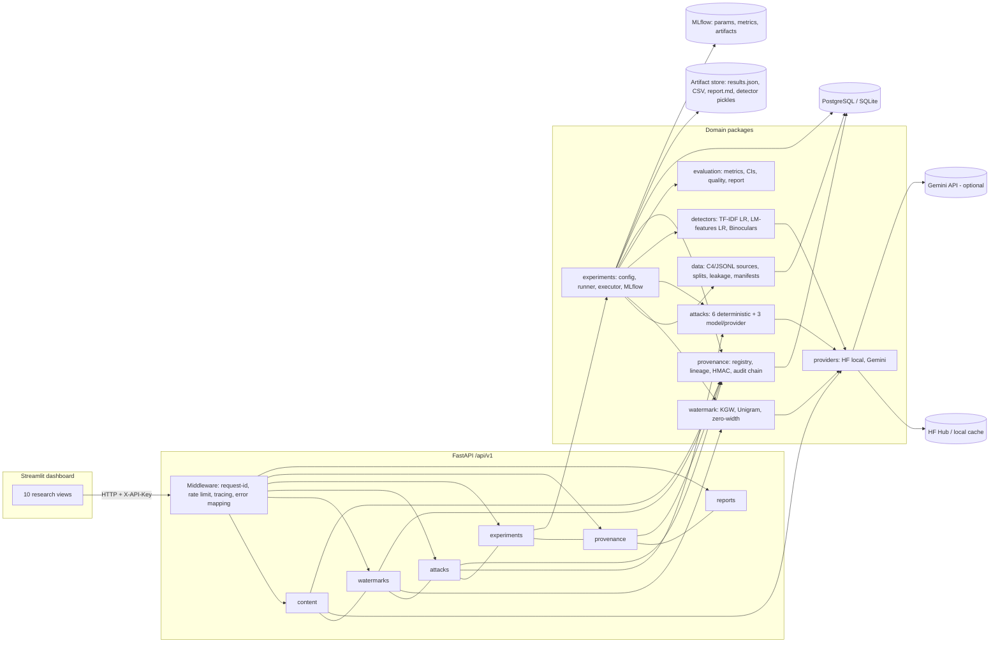
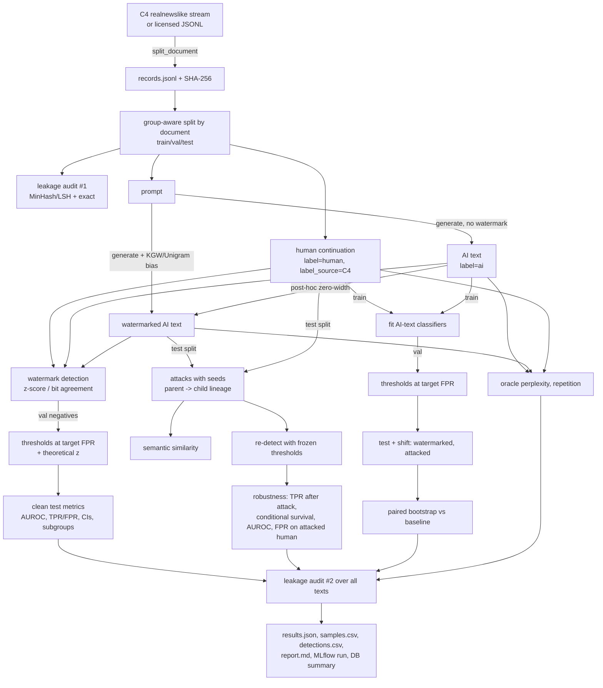
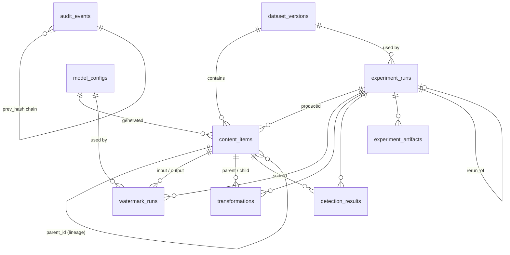

# MAI-13 Architecture

## 1. Design goals and constraints

| Goal | Consequence in the design |
|---|---|
| Scientific validity | Held-out test split, thresholds chosen on validation only, group-aware splits, leakage audit, CIs everywhere, skipped/failed work reported explicitly. |
| Reproducibility | Every experiment = validated config + seed + dataset version (SHA-256) + software version + git commit + environment; deterministic seeds derived from stable IDs; a rerun endpoint. |
| Separation of concerns | Watermark embedding, watermark detection, AI-text classification and provenance verification are separate packages with separate DB rows (`detector_type`). |
| Runs on a laptop CPU | Small open models (Qwen2.5-0.5B, GPT-2 family, MarianMT, MiniLM); optional providers degrade gracefully. |
| Simplicity | One FastAPI process with an in-process job pool; PostgreSQL (or SQLite locally); no queue/K8s/vector DB. |

## 2. Component view

## 3. Experiment data flow

## 4. Database schema (normalised)

Key constraints (migration `0001_initial_schema`):
- CHECK constraints on enumerations (`source_type`, `label`, `split`, `status`, `decision`, `detector_type`).
- Unique `(dataset_versions.name, version)`, `(experiment_artifacts.experiment_run_id, name)`,
  `model_configs.config_hash`, `audit_events.event_hash`.
- Indexes on hashes, foreign keys, `(dataset_version_id, split)`, `(experiment_run_id, detector_name)`,
  `(entity_type, entity_id)`.
- `content_items.text` is nullable: with `STORE_RAW_TEXT=false` only hashes and lineage are kept.
- JSON columns are `JSONB` on PostgreSQL and `JSON` on SQLite (same migration).

Large objects (dataset records, trained detectors, reports) live in the artifact store;
the DB keeps URIs and SHA-256 digests, which are re-verified on every read through the API.

## 5. Key design decisions

1. **Library-independent green lists.** The reference KGW code seeds `torch.randperm`; detection then
   depends on torch's RNG implementation. MAI-13 uses a keyed splitmix64 PRF (`backend/watermark/prf.py`)
   with golden-value tests, so detection is stable across torch versions and platforms.
2. **Explicit sampling chain.** HF's own warpers are disabled; the processor list is
   `[watermark bias, temperature, top-p]`, so the bias is applied before truncation as in the paper.
3. **"Insufficient" is a first-class decision.** Texts with fewer scorable tokens than `min_tokens`
   return `insufficient`, never `negative`; metrics count them as *not detected* (conservative).
4. **Group-aware splits.** All texts derived from one source document share its split, so
   an attacked text can never be in test while its parent trains a classifier.
5. **Stage-scoped transactions.** The runner commits at progress checkpoints through the stage
   session, so lineage is visible incrementally and SQLite never sees two writers from one run.
6. **Serialised audit chain.** Appends hold a transaction-scoped advisory lock on PostgreSQL
   (process lock on SQLite), so concurrent requests cannot fork the hash chain.
7. **In-process executor.** A bounded thread pool satisfies "long-running jobs return an ID";
   on restart, interrupted runs are marked failed (with a rerun hint) and queued runs are resubmitted.
   A Celery/Redis executor can implement the same `JobExecutor` interface for multi-node use.

## 6. Extending to image and audio (Phase 6)

The text pipeline is modality-specific in four places, each behind an interface:

| Interface | Text implementation | Image/audio adapter would provide |
|---|---|---|
| `WatermarkMethod.embed/detect/get_metadata` | KGW, Unigram, zero-width | e.g. Tree-Ring / StegaStamp (image), AudioSeal (audio) |
| `Attack.apply(text, seed)` | edits, translation, paraphrase | JPEG/crop/resize/noise; resampling/compression/time-stretch |
| `AITextDetector.fit/score` | TF-IDF, LM features | image/audio forensic classifiers |
| `content_items.modality` + artifact store | text in DB | binary payload in artifact store, perceptual hash in DB |

The runner would need modality-specific quality metrics (PSNR/SSIM/LPIPS; PESQ/STOI) in place of
perplexity and semantic similarity. **None of this is implemented**; the platform is text-only
and makes no multimodal claims (see `docs/PHASE6_MODALITY_DECISION.md`).
